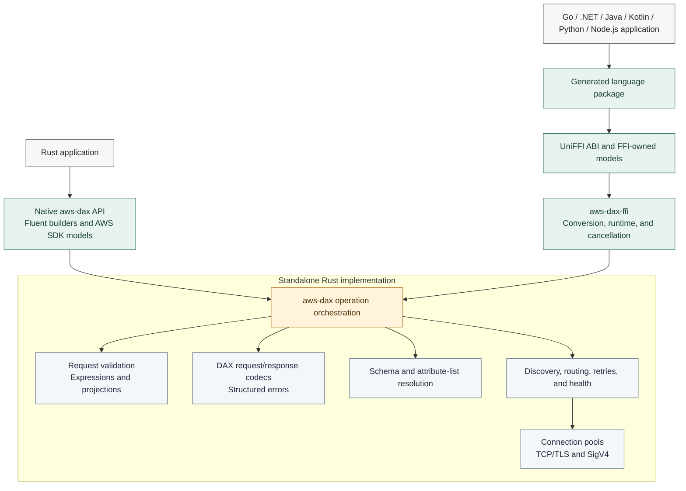

# Standalone AWS DAX SDK and Multi-Language Bindings - Feature Proposal

> **Purpose:** This document presents a proof of concept for a standalone AWS
> DAX SDK architecture. The Rust `aws-dax` crate is a complete, independently
> usable SDK and the single implementation of DAX behavior. A Rust-owned
> UniFFI facade generates Go, .NET/C#, Java, Kotlin/JVM, Python, and Node.js
> packages from that same implementation. The proof demonstrates that one
> standalone SDK can serve Rust directly and act as the foundation for all
> other language clients without duplicating protocol, routing, retry, or
> lifecycle behavior.
>
> **Review expectation:** This proposal documents and validates an implemented
> proof of concept rather than introducing a design from scratch. No package
> has been published and no release approval is implied.
>
> **Feedback scope:** Reviewers are asked to confirm the standalone-core
> architecture, the generated multi-language model, the public SDK and FFI
> compatibility boundaries, and the proposed path from proof of concept to
> supported releases.

### Stakeholders

- **Owner:** Radu Gribincea
- **Primary reviewers:** AWS DAX service team, AWS SDK for Rust maintainers
- **Secondary reviewers:** DynamoDB SDK and developer-experience stakeholders

### Document Phase

**DRAFT - Proof of Concept Validated, Product Alignment Pending**

## Decision Requested

Approve the standalone Rust SDK plus Rust-owned UniFFI architecture as the
direction for developing DAX clients across the supported languages, and
approve continued work toward a coordinated public preview. This proposal does
not request publication approval.

### Scope Status

- **Demonstrated by the proof of concept:** one Rust implementation of DAX
  behavior, a standalone Rust SDK, a Rust-owned FFI contract, generated binding
  surfaces, and native package assembly.
- **Preliminary live results:** generated clients in all six ecosystems
  successfully execute GetItem and PutItem workloads against DAX through the
  shared Rust SDK. These runs demonstrate the core proof of concept: one Rust
  implementation can serve multiple languages through FFI. The measurements
  provide an initial development baseline, not an apples-to-apples performance
  comparison; see Performance below.
- **Next-stage validation:** build on this proof of concept with broader live
  operation coverage, fault injection, artifact-only installation,
  native-target validation, and performance characterization, including direct
  Rust and isolated FFI overhead.
- **Required before general availability:** stable public and FFI contracts,
  assigned long-term ownership, release evidence across the target matrix, and
  explicit publication approval.

## Problem Statement

### What is the problem and why solve it

There are two related problems:

1. **Every supported SDK requires a separate DAX implementation.** Each
  language team must build and maintain the same protocol, authentication,
  discovery, routing, retry, pooling, expression, and error behavior. This
  duplicates substantial engineering work and allows implementations to drift.
2. **Customers must choose a DAX-supported language.** Applications written in
  other languages cannot use DAX through their normal SDK. Customers must
  change languages, introduce an additional service boundary, or give up DAX.

This proof of concept tests whether one standalone Rust SDK can solve both
problems: Rust customers use it directly, while other SDKs are generated from a
shared UniFFI contract backed by the same implementation.

### Why does this problem exist

DAX clients are not ordinary HTTP service clients. They implement a binary CBOR
protocol over persistent TCP or TLS connections and own cluster discovery,
request routing, authentication refresh, schema compression, connection pools,
health checks, and retry behavior. A generated service client cannot provide
this behavior by itself.

The Go client is the available behavioral reference, but porting it separately
to every language repeats the most complex work. The proposed architecture
implements that behavior once in Rust, keeps Rust as a first-class standalone
SDK, and exposes a stable language-neutral contract for generated clients.

### How are customers solving this problem today

Customers who need DAX generally select one of the languages with an existing
DAX client. If their application uses another language, they must either forgo
DAX or move DAX access behind a service written in a supported language.

Internally, adding another supported language means developing and maintaining
another DAX SDK implementation. The customer limitation and the repeated SDK
work are therefore two sides of the same problem.

### Has a similar problem been solved before

The pinned `aws-dax-go-v2` client solves the protocol and cluster-management
problem for Go. This project uses that implementation as the compatibility
oracle while expressing the direct API in AWS SDK for Rust style. UniFFI then
projects an FFI-safe contract into six ecosystems. The result is one behavioral
implementation with multiple generated API surfaces, not seven ports.

## Tenets

### Preserve DAX behavior

Wire encoding, validation, retry classification, endpoint discovery, routing,
TLS behavior, and pagination should match the pinned reference unless a
documented Rust convention requires a deliberate difference.

### Feel native to AWS SDK for Rust users

The client should use async fluent builders and AWS SDK for Rust DynamoDB input,
output, and `AttributeValue` types wherever practical. It must not expose
internal protocol or transport types.

### Keep one source of DAX behavior

Protocol encoding, validation, credentials, TLS, retries, routing, pagination,
cancellation, and shutdown remain in Rust. Generated bindings only convert
language-native values to the reviewed FFI contract and invoke `aws-dax-ffi`.
They do not implement separate request encoding, routing, retry, or pagination
logic; updates to those behaviors are made once in `aws-dax` and delivered to
each language package through its matching native library.

### Make the shared core independently useful

The Rust crate must remain publishable, documented, and usable without UniFFI.
FFI concerns must not leak into its public API or internal protocol design.

### Generate language surfaces from one reviewed contract

Only FFI-owned records, enums, errors, and objects cross the ABI. One contract,
fixture corpus, and version train govern all generated packages.

### Reject rather than reinterpret

Unsupported operations, fields, response shapes, and expression forms must
return stable, actionable errors. The client must never fall back silently to
DynamoDB or send a request with changed meaning.

### Make lifecycle behavior explicit

Clients are safe to clone and use concurrently. Closing a client is idempotent
and deterministically stops background work and closes idle connections.

### Treat security as part of compatibility

Credentials and customer data are never logged. TLS verification is enabled by
default. The hostname-verification override is an explicit compatibility option
for controlled environments, not a recommended production default.

### Prove parity with executable evidence

Golden vectors, imported reference fixtures, property tests, fuzz targets,
transport tests, and opt-in live tests are part of the feature, not follow-up
work.

## Intended Customer Experience

### What does the proof of concept provide

The proof provides two layers that can be released together or independently:

1. A standalone, opt-in Rust crate named `aws-dax` that integrates with AWS SDK
  for Rust shared configuration and DynamoDB models.
2. An `aws-dax-ffi` facade that generates installable Go, .NET/C#, Java,
  Kotlin/JVM, Python, and Node.js packages backed by the same Rust SDK.

Both layers provide asynchronous access to DAX for:

- `GetItem`
- `PutItem`
- `DeleteItem`
- `UpdateItem`
- `Query`
- `Scan`
- `BatchGetItem`
- `BatchWriteItem`
- `TransactGetItems`
- `TransactWriteItems`

The proof also includes Query, Scan, and BatchGet paginators, explicit endpoint
discovery and refresh, route diagnostics, structured errors, cancellation, and
deterministic client shutdown across every generated consumer.

### Key benefits

- DAX access without leaving the Rust process or maintaining a protocol client.
- Familiar AWS SDK for Rust configuration, types, and operation flow.
- Go-reference-compatible transport and cluster behavior.
- Explicit compatibility boundaries that fail before network I/O.
- Deterministic lifecycle management for long-running services.
- One implementation to audit, test, optimize, and secure.
- Generated language packages that inherit fixes and compatibility behavior
  from the standalone core.
- No service boundary or sidecar for non-Rust applications; each generated
  package loads the native SDK in-process.

### Why should I use this client

Use `aws-dax` directly when a Rust application needs DAX acceleration with
AWS SDK-style request models and async ergonomics. Use a generated package when
another supported language needs the same DAX behavior without maintaining an
independent protocol implementation. Continue using a DynamoDB SDK directly
when an application does not use DAX or requires operations DAX does not
implement.

### How do I use the client

```rust,no_run
use aws_dax::Client;
use aws_sdk_dynamodb::types::AttributeValue;

# async fn example() -> Result<(), aws_dax::Error> {
let sdk_config = aws_config::load_from_env().await;
let client = Client::from_sdk_config(
    &sdk_config,
    "dax://example-cluster:8111",
)?;

let output = client
    .get_item()
    .table_name("Example")
    .key("id", AttributeValue::S("42".into()))
    .send()
    .await?;

client.close()?;
# Ok(())
```

Inputs assembled elsewhere can be supplied to operation builders, and outputs
use the corresponding generated DynamoDB output models.

## Design Decisions at a Glance

1. **Compatibility reference:** Pin `aws-dax-go-v2` `v1.0.3` and incorporate
   upstream changes only through an explicit compatibility review.
2. **Implementation ownership:** Keep all DAX behavior in the standalone Rust
  SDK; the FFI layer only converts, dispatches, and manages ABI concerns.
3. **Rust API shape:** Use AWS SDK for Rust-style async fluent builders.
4. **Rust public models:** Reuse public DynamoDB SDK models where suitable; keep DAX
   protocol types private.
5. **FFI models:** Export only language-neutral, FFI-owned records and tagged
  values; never expose AWS SDK generated Rust types across the ABI.
6. **Runtime:** Use the caller's Tokio runtime in direct Rust use and one
  Rust-owned process-wide runtime for generated foreign clients.
7. **Errors:** Return structured SDK and FFI errors that preserve DAX,
   transport, validation, and transaction details.
8. **Expressions:** Support a tested, bounded grammar and reject unsupported
   forms explicitly.
9. **Network behavior:** Preserve Go-compatible discovery, routing, connection
   authorization, pooling, retries, health checks, and fail-open behavior.
10. **Generated APIs:** Use one UniFFI dependency train and generated surfaces
   without handwritten per-language DAX behavior.
11. **Distribution:** Package native artifacts for `linux-x86_64`,
  `linux-aarch64`, `osx-x86_64`, `osx-arm64`, and `windows-x86_64`, and verify
  generated/native compatibility with contract checksums.
12. **Live tests:** Keep account-dependent tests opt-in while maintaining
   offline conformance coverage by default.

## High-Level Design



The standalone crate owns operation orchestration and every DAX behavior. The
FFI crate depends on it and owns only the stable ABI, bounded conversion,
foreign async execution, cancellation, and package-facing lifecycle. Generated
code contains no protocol logic.

## Feature Breakdown

### Client and configuration

- Construct from AWS SDK shared configuration and one or more DAX endpoints.
- Validate endpoint schemes, retry and timeout settings, IP discovery policy,
  and connection limits.
- Support plaintext `dax://` and TLS `daxs://` endpoints.
- Share one closed state, route table, pools, and lifecycle tasks across clones.

### Operations and models

- Expose the ten supported DAX data-plane operations through fluent builders.
- Reuse AWS SDK for Rust DynamoDB inputs, outputs, and attribute values.
- Load key schemas and compressed attribute lists through single-flight control
  requests.
- Preserve consumed-capacity, item-collection, unprocessed-item, and transaction
  cancellation information where supported by the bounded response model.

### Expressions and pagination

- Support bounded key-condition, filter, projection, condition, and update
  expression forms proven against Go golden vectors.
- Support aliases, values, nested document paths, and non-negative list indexes.
- Provide lazy Query, Scan, and BatchGet paginators with continuation-token
  handling, route affinity, failover, and duplicate-token protection.

### Transport and cluster behavior

- Encode and decode the DAX CBOR protocol.
- Authenticate persistent connections with DAX SigV4 framing.
- Discover and atomically replace endpoint rosters.
- Route requests round-robin across healthy nodes with seed fallback.
- Pool and reap connections, bound pending connection attempts, and replace
  failed pools.
- Apply separate read and write retry budgets, fixed non-throttle delays, and
  Go-compatible equal-jitter throttle backoff.
- Run bounded endpoint-refresh and health-check tasks with deterministic
  cancellation.

### Error model and diagnostics

- Distinguish configuration, validation, closed-client, transport, protocol,
  DAX service, and unsupported-operation failures.
- Retain request IDs, status, code sequences, retryability, fault
  classification, and structured transaction cancellation reasons when present.
- Expose endpoint and route snapshots without logging credentials or item data.

### Rust-owned FFI contract

- Represent DynamoDB values as a bounded tagged union that preserves number
  strings and binary data.
- Export immutable request and response records for all ten operations.
- Export stateful Query, Scan, and BatchGet paginator objects.
- Preserve structured validation, transport, protocol, service, timeout,
  cancellation, and closed-client errors.
- Use Rust's default AWS region and credential-provider chain without exporting
  credentials or signing material.
- Own foreign async execution and cancellation on one process-wide Tokio
  runtime.

### Generated packages and native artifacts

- Generate Go/cgo, .NET 8, JDK 21 Java, Kotlin/JVM 21, Python 3, and Node 22
  N-API surfaces from one UniFFI contract.
- Package the five native targets defined by the packaging matrix:
  `linux-x86_64`, `linux-aarch64`, `osx-x86_64`, `osx-arm64`, and
  `windows-x86_64`.
- Load native libraries package-relatively without loader-path overrides.
- Reject generated/native contract or callable checksum mismatches.
- Produce deterministic archives, SHA-256 manifests, CycloneDX SBOMs, and
  build provenance.

## Limitations of the Design

### Bounded expression compatibility

The client intentionally supports a tested subset of DynamoDB expressions.
Unsupported grammar returns a validation error before network I/O. Expanding
the grammar requires Go-reference fixtures and conformance tests.

### Async runtime dependency

Network operations require Tokio. The crate does not provide a synchronous
client. Direct Rust callers provide a Tokio runtime; generated clients use the
process-wide runtime owned by `aws-dax-ffi`.

### Generated APIs are intentionally language-neutral

The first generated packages do not include handwritten idiomatic facades.
They expose generated names and async shapes governed by UniFFI and the selected
backend. Optional wrappers can be added later without moving DAX behavior out
of Rust.

### Native packages have an explicit platform matrix

The proof supports `linux-x86_64`, `linux-aarch64`, `osx-x86_64`, `osx-arm64`,
and `windows-x86_64`. Kotlin/Native, Kotlin Multiplatform, browser JavaScript,
and WebAssembly are not supported claims.

### Credential customization is bounded

Generated clients use the default AWS credential and region chains in Rust.
Static credentials, arbitrary foreign credential callbacks, and foreign refresh
providers are excluded pending a separate security and lifetime review.

### Reference pinning

Compatibility targets `aws-dax-go-v2` `v1.0.3`. A newer upstream release is not
adopted automatically; it requires fixture regeneration and a parity review.

### Live environment coverage

Default tests are offline. Live plaintext and TLS validation requires a VPC-
reachable DAX cluster and remains opt-in.

## Dependencies Taken

The standalone SDK depends on AWS SDK for Rust configuration, credential, and
DynamoDB crates. Tokio provides asynchronous networking and task support.
Rustls and native certificate roots provide TLS. Small focused crates support
URL parsing, cryptography, UUIDs, serialization, and arbitrary-precision DAX
number handling.

The multi-language layer depends on one pinned UniFFI 0.31 dependency train and
pinned Go, C#, Java, Kotlin, Python, and Node N-API generators. Generator
upgrades are version-coupled and must pass all contract, package, and live gates
together.

Dependency versions are pinned through the workspace and reviewed with
`cargo-deny`. Smithy runtime internals are not exposed in the public API.

## Detailed Design Decisions and Tradeoffs

### AWS SDK models versus crate-owned models

**Recommended:** Reuse AWS SDK for Rust DynamoDB models whenever they represent
the DAX contract accurately.

This minimizes duplicate types and makes migration between DynamoDB and DAX
straightforward. Conversion and validation remain internal where DAX supports a
smaller surface than DynamoDB.

**Feedback requested:** Should the Rust API continue accepting DynamoDB SDK
types and reject DAX-unsupported fields or enum values during validation, or
should it define narrower DAX-specific public types that cannot represent those
options?

### Standalone core versus FFI-first engine

**Recommended:** Keep `aws-dax` independently publishable and free of FFI
concerns. Build `aws-dax-ffi` as a downstream adapter over its public behavior.

This prevents the shared implementation from becoming useful only through
generated bindings. Rust remains a first-class customer, and every foreign
package consumes the same SDK that Rust applications can use directly.

**Feedback requested:** Is the boundary strict enough to preserve independent
Rust SDK evolution while maintaining one behavioral implementation?

### Generated APIs versus handwritten language ports

**Recommended:** Generate the first package surfaces from one reviewed UniFFI
contract and defer handwritten idiomatic facades.

This proves broad availability without creating seven implementations.
Generated APIs may be less idiomatic than bespoke SDKs, but optional wrappers
can improve ergonomics later while delegating all behavior to Rust.

**Feedback requested:** Are generated APIs acceptable for preview, and which
ecosystems require an idiomatic facade before GA?

### Runtime ownership across language boundaries

**Recommended:** Let direct Rust callers supply Tokio and let `aws-dax-ffi` own
one process-wide Tokio runtime for generated clients.

Foreign futures can otherwise be polled without a Tokio reactor. Rust-owned
execution gives every generator consistent timer, cancellation, concurrency,
and shutdown semantics without depending on a foreign event loop.

**Feedback requested:** Does the process-wide runtime model meet embedding and
application-lifecycle requirements in all target ecosystems?

### Fluent builders versus direct input methods

**Recommended:** Present fluent operation builders publicly and retain direct
input execution helpers internally for paginator reuse and testing.

This matches the AWS SDK for Rust experience without coupling transport code to
builder state.

**Feedback requested:** Are the operation names, builder defaults, and input
boundaries consistent with adjacent Rust SDK clients?

### Bounded parser versus complete DynamoDB grammar

**Recommended:** Ship the fixture-backed bounded parser and expand it
incrementally.

A complete independent grammar would materially increase correctness and review
risk. Explicit rejection is safer than accepting syntax whose wire translation
has not been proven against the reference.

**Feedback requested:** Does the documented expression subset cover the minimum
customer workflows required for preview?

### Crate-owned errors versus raw SDK errors

**Recommended:** Use one non-exhaustive crate-owned error contract while
retaining structured service and source information.

DAX failures include protocol code sequences, route and transport state, and
transaction cancellation details that do not map cleanly to generated DynamoDB
SDK errors.

**Feedback requested:** Which error fields and categories must be stable for
the first public release?

### Automatic lifecycle versus explicit startup

**Recommended:** Start refresh, health, and reap schedulers lazily and stop them
through idempotent `close` or final-owner drop.

This keeps basic construction cheap while preserving deterministic shutdown for
services that require it.

**Feedback requested:** Is explicit `close` plus final-owner cleanup sufficient,
or should a scoped ownership helper be added before GA?

## Adoption and Migration

Adoption is opt-in and requires no table or item migration. Rust applications
can use the standalone crate directly and continue using AWS SDK DynamoDB model
types. Applications in the six generated ecosystems install a normal package
that contains the generated API and the matching native library; they do not
deploy a sidecar or separately operate the Rust SDK.

The migration guide documents direct Rust client construction, operations, and
paginator differences from `aws-dax-go-v2`. Each generated package includes an
artifact-only example that proves package-relative native loading and a
cleanup-safe Put/Get/Delete workflow.

The DAX protocol already carries SDK and version identifiers in its handshake
and authorization messages. The proposal should preserve that mechanism and
define stable identifiers for the standalone Rust SDK and generated packages,
without adding customer-specific identifiers or recording customer data.

### Proposed success metrics

- **Correctness:** no open data-integrity or P0/P1 correctness issues for 60
  consecutive days before GA.
- **Compatibility:** all imported golden fixtures and the supported SDK/FFI
  live operation matrix remain green for every release candidate.
- **Reliability:** discovery, failover, retry, paginator, cancellation, and
  shutdown tests pass in Rust and every generated consumer without regressions.
- **Architecture:** confirmed DAX behavior is implemented or fixed once in
  `aws-dax`, with no language-specific protocol patches.
- **Packaging:** all six packages install from release-candidate artifacts on
  `linux-x86_64`, `linux-aarch64`, `osx-x86_64`, `osx-arm64`, and
  `windows-x86_64` without loader-path overrides.
- **SDK attribution:** DAX telemetry can distinguish requests from the Rust SDK
  and each generated package by SDK and version, using only protocol-level
  identifiers and no customer data.
- **Adoption:** at least one representative workload in Rust and three
  generated ecosystems complete a documented preview migration.
- **Supportability:** reported failures contain a stable category and actionable
  context without credentials or customer item data.

## Validation

The implementation is validated in layers:

- exact Go-derived CBOR and expression golden vectors;
- unit and property tests for values, validation, caches, routing, and retries;
- fuzz targets for untrusted DAX decoders and conversion boundaries;
- controlled local transport fixtures for framing, pooling, retry, and lifecycle;
- compile-checked public API and migration examples;
- bounded FFI value-conversion, lifetime, concurrency, cancellation, and
  shutdown tests;
- generated API snapshots and deterministic binding generation for all six
  ecosystems;
- clean artifact-only installation and native loading for every generated
  package;
- Clippy, formatting, documentation, package-content, and dependency-policy
  checks; and
- opt-in plaintext and TLS live tests for all supported operations, discovery,
  routing, paginators, structured errors, cancellation, and shutdown.

**Preliminary results:** Live GetItem and PutItem runs demonstrate the shared
Rust SDK serving generated clients across six ecosystems. They provide an
initial performance baseline and support continued development of the FFI
architecture, rather than a claim of production performance or release readiness.

| Evidence area | Status to record | Required details |
| --- | --- | --- |
| Test environment | Preliminary live benchmark completed | Generated clients use the shared Rust SDK in-process on EC2 `c6i.2xlarge`, Amazon Linux 2023 x86_64; three `dax.r5.large` nodes in eu-west-1; plaintext `dax://` |
| Operation matrix | Preliminary GetItem/PutItem execution demonstrated | All six generated ecosystems exercised over plaintext on Linux x86_64; broader operation and behavioral parity, direct Rust, and TLS validation are next-stage work |
| Fault injection | `[Pending]` | One-node TLS failure, recovery behavior, and cleanup result per ecosystem |
| Package installation | `[Pending]` | Artifact-only installation, native loading, and absence of loader-path overrides |
| Native targets | Linux x86_64 exercised in live workloads | All six generated ecosystems ran on `linux-x86_64`; broader package/native-binary validation and execution on `linux-aarch64`, `osx-x86_64`, `osx-arm64`, and `windows-x86_64` remain planned |
| Performance | Preliminary PoC baseline: GetItem and PutItem, six ecosystems | Live workloads demonstrate the FFI execution path; the current PoC is slower than native baselines. Fixed single-worker throughput, mean latency, observed CPU, and scope are documented below |
| Reports | Preliminary benchmark report available | [Benchmark results](https://gist.github.com/raduendv/84d12d2f672afe30ef02d9427f9e0863#file-fixed-workload-complete-md), including the Markdown report, CSV measurements, and JSON metadata |

## Versioning Strategy

The `aws-dax` and `aws-dax-ffi` crates and all generated packages use one
semantic version. Generated packages declare the native version exactly, and
contract checksums reject incompatible native libraries.

The project begins at `0.1.0` for public preview. During preview, compatibility
changes must be documented and minimized, but semver permits necessary API and
ABI corrections before `1.0.0`.

Version `1.0.0` should require:

- approved public API and stable error contract;
- approved FFI contract and generated API snapshots;
- no open correctness or data-integrity defects;
- an up-to-date compatibility matrix and migration guide;
- successful package validation on the MSRV and stable Rust;
- successful plaintext and TLS release-candidate validation across all seven
  consumption paths and the five native targets listed above; and
- explicit publication approval.

## Impact of the Design

### Performance

The client adds DAX-specific validation, encoding, routing, and pool management
inside the process. Persistent connection reuse, cached schemas and attribute
lists, single-flight control loads, and bounded allocations limit overhead.

#### Preliminary results: live native/FFI comparison

The preliminary live runs documented in the
[benchmark report](https://gist.github.com/raduendv/84d12d2f672afe30ef02d9427f9e0863#file-fixed-workload-complete-md)
demonstrate that generated
.NET, Go, Java, Node.js, Kotlin, and Python packages can execute GetItem and PutItem
workloads against DAX through the same Rust SDK. This supports the feasibility
of one shared implementation serving multiple language ecosystems in-process.
The purpose of these runs is to demonstrate live execution through FFI and
establish an initial development baseline, not to provide an apples-to-apples
performance comparison. The existing clients provide reference measurements;
the current PoC records lower throughput in this workload, but these results
do not isolate the cost of FFI or establish the architecture's performance
potential.

Here, **native** means the existing client for each language, not direct Rust;
**FFI** means the baseline generated `0.1.0` package built from Rust source
`01babe0243e0278195d40a745e6c41d833e97b4b`, not the experimental Go candidate v5.

**Environment and method:**

- Runner: EC2 `c6i.2xlarge`, Amazon Linux 2023 x86_64.
- Cluster: three `dax.r5.large` nodes across `eu-west-1a`, `eu-west-1b`, and
  `eu-west-1c`; plaintext `dax://`, not TLS.
- Workload: GetItem and PutItem over sixteen previously seeded keys in
  `ffi_benchmark_shared`, one worker, two-minute warmup and five-minute
  measurement windows, three repetitions per comparison, alternating
  native/FFI order. The single-worker rows define this comparison, not the
  adaptive-worker or target-CPU settings retained in the workload metadata.
- Runtimes: .NET 8.0.13, Go 1.26.0, OpenJDK 21.0.12.1, Node.js 22.23.2,
  and CPython 3.13.15;
  the Kotlin native baseline uses Kotlin 2.1.20 and the Java DAX client.
- Native baselines: .NET `AWSSDK.DAX.Client` 4.1.0, Go `aws-dax-go-v2` 1.0.3, Java/Kotlin
  `software.amazon.dax:amazon-dax-client` 2.0.11, Node.js
  `@amazon-dax-sdk/lib-dax` 3.1.0, and Python `amazon-dax-client` 2.1.0.

Throughput and mean latency below are medians across repetitions, not pooled
latencies or latency percentiles. Observed CPU is the median of per-run means
of fully contained whole-process minutes; it includes warmup, while local
latency does not. This is not a matched-DAX-CPU comparison.

| Language | Operation | Native ops/s | FFI ops/s | FFI/native | Native mean us | FFI mean us | Native observed CPU | FFI observed CPU |
| --- | --- | ---: | ---: | ---: | ---: | ---: | ---: | ---: |
| .NET | GetItem | 2881.98 | 173.30 | 0.060x | 345.79 | 5737.13 | 3.67% | 2.68% |
| .NET | PutItem | 187.25 | 160.19 | 0.856x | 5338.59 | 6239.86 | 4.67% | 5.54% |
| Go | GetItem | 2988.57 | 173.58 | 0.058x | 329.84 | 5741.31 | 4.12% | 2.94% |
| Go | PutItem | 186.83 | 157.15 | 0.841x | 5346.25 | 6356.22 | 4.88% | 5.12% |
| Java | GetItem | 2662.98 | 173.15 | 0.065x | 371.26 | 5763.79 | 3.42% | 3.41% |
| Java | PutItem | 188.34 | 158.31 | 0.841x | 5301.69 | 6308.57 | 5.12% | 4.77% |
| Node.js | GetItem | 2249.69 | 173.18 | 0.077x | 400.94 | 5707.49 | 3.30% | 2.60% |
| Node.js | PutItem | 191.48 | 159.15 | 0.831x | 5178.44 | 6228.78 | 4.83% | 4.94% |
| Kotlin | GetItem | 2627.94 | 174.01 | 0.066x | 376.14 | 5723.90 | 4.36% | 2.82% |
| Kotlin | PutItem | 188.15 | 158.71 | 0.843x | 5306.45 | 6291.03 | 4.92% | 5.04% |
| Python | GetItem | 2176.66 | 173.03 | 0.079x | 448.10 | 5751.25 | 3.44% | 2.56% |
| Python | PutItem | 187.72 | 152.33 | 0.811x | 5311.18 | 6543.95 | 5.57% | 5.03% |

**Interpretation:** The runs provide preliminary evidence that the FFI-based
client model works across six ecosystems, while quantifying the performance
work needed to develop the PoC further. In this workload, FFI GetItem
throughput is 5.8%-7.9% of
the corresponding native baseline, with mean latency around 5.71-5.76 ms
versus 0.33-0.45 ms. FFI PutItem throughput is 81.1%-85.6% of native, with
mean latency around 6.23-6.54 ms versus 5.18-5.35 ms. Improving performance,
particularly GetItem, is a priority for the next development phase. These
end-to-end comparisons do not isolate ABI overhead or identify a root cause;
the measured gap should not be attributed to FFI alone.

**Accepted warmup deviations:** The report includes all six ecosystems under
a reviewed 10 ms warmup-only allowance, accepted on 2026-10-16. The .NET FFI
GetItem run at index 14 (zero-based) was 6.9939 ms short of the 120-second
warmup; the .NET native PutItem run at index 21 was 4.6791 ms short. All
300-second measurement windows remain intact. No runs were repeated or
repetitions removed; error checks and evidence validation are unchanged.

**Supporting results:** The
[benchmark gist](https://gist.github.com/raduendv/84d12d2f672afe30ef02d9427f9e0863#file-fixed-workload-complete-md)
contains the Markdown report,
[CSV measurements](https://gist.github.com/raduendv/84d12d2f672afe30ef02d9427f9e0863#file-fixed-workload-complete-csv)
with ranges, and
[JSON metadata](https://gist.github.com/raduendv/84d12d2f672afe30ef02d9427f9e0863#file-fixed-workload-complete-json)
with workload, environment, artifact identities, and source hashes.

The next step is to build on this feasibility evidence with profiling and
optimization, then broaden benchmarking to direct Rust, isolated FFI overhead,
TLS, concurrency scaling, tail latency, startup, memory, allocations, pool
contention, failover, and additional native targets.
The present results describe this fixed workload; they do not establish CPU
efficiency, maximum throughput, or production readiness.

### Security and privacy

- Credentials, secrets, item values, and customer data must never be logged.
- TLS uses native trust roots and discovery-hostname SNI.
- Hostname verification is enabled by default.
- Untrusted lengths, nesting, cancellation arrays, and collection sizes are
  bounded before allocation.
- Dependency, license, secret, and package-content checks are release gates.

### Testing and operations

No service-side change or new DAX operational tooling is required. The client
exposes route snapshots and last-refresh diagnostics for application
observability. Generated packages add native artifact build, integrity,
provenance, and ecosystem publication work. Live validation infrastructure is
required for release candidates but not for normal consumers.

### Operating model and ownership

The preview must assign named owners for the following boundaries:

- **Rust core:** DAX protocol, transport, routing, retries, lifecycle, and
  parity updates against the pinned Go reference.
- **FFI contract:** ABI evolution, generated API snapshots, conversion limits,
  runtime ownership, cancellation, and structured errors.
- **Package distribution:** native builds, target validation, deterministic
  assembly, checksums, SBOMs, and registry-specific release work.
- **Security and operations:** dependency response, artifact signing and
  provenance, credential handling, vulnerability response, and live-test
  environment ownership.

The owner for each boundary is `[TBD]` until the preview operating model is
approved.

### Existing features and services

The client is additive. It does not alter DAX, DynamoDB, or AWS SDK for Rust
service behavior, and it does not replace the DynamoDB client for unsupported
operations.

### Future projects

- Expand expression compatibility from new Go-reference fixtures and customer
  use cases.
- Review newer `aws-dax-go-v2` releases through an explicit parity update.
- Add telemetry needed to measure operation-level adoption without customer
  data.
- Add optional handwritten idiomatic facades where customer feedback shows
  that generated APIs are insufficient, while keeping all DAX behavior in Rust.
- Evaluate additional native targets and ecosystems only after the shared
  contract and release process are stable.

## Proposed Delivery Plan

### Phase 1 - Alignment and preview hardening

- Review the standalone SDK API and the language-neutral FFI contract.
- Review generated API snapshots and package ergonomics for all six ecosystems.
- Freeze the preview compatibility table, expression subset, ABI rules, and
  five-target package matrix.
- Decide the client-identification and adoption-telemetry strategy without
  breaking handshake compatibility.
- Run the complete offline validation matrix on Rust 1.85 and stable.
- Re-run plaintext and TLS parity from packaged release-candidate artifacts in
  all seven consumption paths.
- Use the preliminary live results as the starting point for profiling and
  optimization, prioritizing GetItem; publish methodology and updated results
  as coverage expands to direct Rust, TLS, concurrency, tail latency,
  and resource usage.
- Assign ownership for native builds, generator updates, security response, and
  each ecosystem registry.

### Phase 2 - Coordinated public preview

- Publish `aws-dax`, `aws-dax-ffi`, and the six generated packages at one `0.x`
  semantic version after explicit approval.
- Provide standalone Rust and per-ecosystem getting-started, compatibility,
  native-loading, lifecycle, and troubleshooting docs.
- Validate registry-downloaded artifacts rather than source-tree outputs.
- Classify incoming issues as correctness, compatibility, API ergonomics,
  generator, packaging, performance, or documentation defects.
- Add a regression test for every confirmed protocol or lifecycle defect.

### Phase 3 - Stabilization

- Validate at least three representative workloads.
- Resolve SDK, FFI, generated API, and error-contract feedback while semver
  still permits preview corrections.
- Re-run conformance, live tests, fuzz campaigns, and benchmarks for each
  release candidate.
- Confirm that all documented compatibility edges remain intentional.
- Confirm that fixes continue to land in the Rust core rather than in generated
  language packages.

### Phase 4 - General availability

- Confirm no open correctness or data-integrity defects.
- Freeze the `1.0` Rust API, FFI ABI, generated APIs, and compatibility
  guarantees.
- Publish `1.0.0` with release notes, migration guidance, and benchmark results.
- Establish an upstream-reference update and security-response process.

## Open Questions and Next Steps

1. Which team owns final API and release approval?
2. Which error fields and variants are guaranteed stable at `1.0`?
3. Is the current bounded expression subset sufficient for public preview?
4. Are the protocol user-agent and authorization identifiers sufficient for
  aggregate SDK attribution, and which identifiers should Rust and each
  generated package use?
5. Which live DAX environments and architectures are mandatory release gates?
6. What adoption threshold, if any, is required before `1.0`?
7. Should preview publication be simultaneous or staged by ecosystem under one
  shared compatibility and versioning policy?
8. Which generated ecosystems require handwritten ergonomic wrappers before
  GA, if any?
9. What customer requests, workloads, or adoption signals should be included
   to quantify demand for DAX outside the currently supported SDK languages?
10. Who owns the Rust core, FFI contract, package distribution, and security
  response after preview?
11. How should this approach be compared with separate language SDKs, a
  service/sidecar, or a C ABI-based native client?

## Appendix

### Appendix A: Go-to-Rust experience

Go:

```go
cfg, err := config.LoadDefaultConfig(context.Background())
if err != nil {
    return err
}

client, err := dax.NewFromConfig(cfg, "dax://cluster.example.com:8111")
if err != nil {
    return err
}
```

Rust:

```rust,no_run
use aws_dax::Client;

# async fn example() -> Result<(), aws_dax::Error> {
let sdk_config = aws_config::load_from_env().await;
let client = Client::from_sdk_config(
    &sdk_config,
    "dax://cluster.example.com:8111",
)?;
# Ok(())
```

The operation names remain the same. Rust uses fluent builders and `.await`,
while operation inputs and outputs use AWS SDK for Rust DynamoDB models.

### Appendix B: Review plan

1. **Public API and models:** client construction, configuration, builders,
   paginator ergonomics, AWS SDK type reuse, and unsupported-state handling.
2. **Protocol and expressions:** CBOR, key and attribute-list compression,
   request/response framing, parser bounds, and Go golden vectors.
3. **Transport and security:** TLS, SigV4 authorization, pooling, timeouts,
   retries, response drainage, and sensitive-data handling.
4. **Cluster lifecycle:** discovery, route selection, suppression, fail-open,
   health checks, refresh, reaping, clone behavior, and shutdown.
5. **Errors and diagnostics:** stable categories, source preservation,
   transaction reasons, request metadata, and route observability.
6. **FFI contract and runtime:** bounded values, request/response parity,
  cancellation, concurrency, shutdown, panic containment, and ABI evolution.
7. **Generated APIs:** naming snapshots, async shapes, error mapping, object
  disposal, and absence of language-specific DAX behavior.
8. **Packages and supply chain:** target matrix, native loading, deterministic
  assembly, checksums, SBOMs, provenance, dependency policy, and MSRV.
9. **Release evidence:** tests, fuzzing, live matrix, fault injection,
  benchmarks, documentation, and artifact-only examples.

### Appendix C: Proof-of-concept evidence

The Rust crate is the sole implementation of DAX behavior. The workspace also
contains a Rust-owned UniFFI facade and generated bindings for Go, .NET, Java,
Kotlin, Python, and Node.js. Those packages delegate protocol, routing, retries,
pagination, and lifecycle behavior to `aws-dax`.

| Proof area | Result |
| --- | --- |
| Standalone Rust SDK | All ten operations, three paginators, discovery, routing, retries, lifecycle, and structured errors implemented |
| Shared FFI contract | Documented operation parity using FFI-owned bounded types; no AWS SDK types cross the ABI |
| Generated ecosystems | Go, .NET, Java, Kotlin/JVM, Python, and Node/N-API generated from one pinned UniFFI train |
| Preliminary live performance | GetItem/PutItem workloads run through the shared Rust SDK from .NET, Go, Java, Node.js, Kotlin, and Python, supporting FFI feasibility. The PoC is slower than native baselines: FFI/native throughput 0.058x-0.079x for reads and 0.811x-0.856x for writes in this plaintext single-worker workload. See Performance for methodology and scope |
| Live operation coverage | Preliminary live GetItem/PutItem execution demonstrated across all six generated ecosystems on Linux x86_64 over plaintext; broader operation and behavioral parity, direct Rust, and TLS validation are next-stage work. See the [benchmark results](https://gist.github.com/raduendv/84d12d2f672afe30ef02d9427f9e0863#file-fixed-workload-complete-md) |
| Failure behavior | `[Pending: record one-node TLS fault-injection and cleanup results for each generated ecosystem]` |
| Package installation | `[Pending: record artifact-only installation and native-loading results without loader-path overrides]` |
| Native targets | `linux-x86_64` exercised by all six generated ecosystems in live GetItem/PutItem workloads; broader package/native-binary validation and execution on `linux-aarch64`, `osx-x86_64`, `osx-arm64`, and `windows-x86_64` remain planned |
| Integrity and supply chain | Deterministic archives, contract checksums, SHA-256 manifests, SBOMs, secret scanning, and provenance implemented |
| Publication | Intentionally not performed; explicit approval remains required |

The proof is therefore not only that bindings can be generated. It demonstrates
that one standalone SDK can retain its native developer experience while also
serving as the tested implementation behind complete, installable SDK packages
for six other ecosystems.

## Meeting Notes

None yet.
